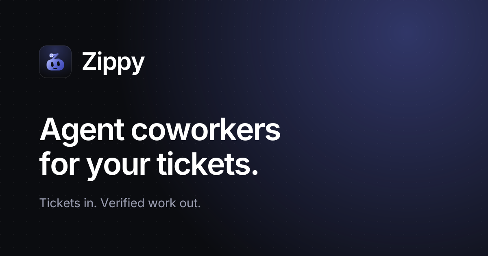

<p align="center">
  
</p>

<h1 align="center">Zippy</h1>

<p align="center">
  <b>Agent coworkers for your tickets.</b> A local, open-source task board that hands tickets to Claude Code agents and brings back work you can verify.
</p>

<p align="center">
  <a href="LICENSE"></a>
  
  
  <a href="https://s-azizkhan.github.io/zippy/"></a>
</p>



Zippy is an agentic task manager for developers who use [Claude Code](https://docs.anthropic.com/en/docs/claude-code). Write a ticket (or sync one from Linear), and Zippy runs Claude Code agents on it in an isolated git worktree over the [Agent Client Protocol (ACP)](https://agentclientprotocol.com). You review the diff, tests and screenshots, then approve.

Everything runs on your machine with your existing `claude` login. No API keys, no cloud sandbox, no server to host.

## Features

- **Tickets → agents → you verify.** Kanban board and inbox with decision cards, approvals and PRs to review.
- **Agent pipelines.** Chain role agents (validator → planner → executor → reviewer) with `@mentions` and routing rules.
- **Git worktree per ticket.** Agents work in parallel without touching your checkout; `gh` opens the PR.
- **Linear sync.** Linear issues mirror into Zippy, status flows back.
- **Built-in terminals and browser.** Live Claude session status, headless Chromium with DevTools, browser tools for agents behind approval cards.
- **Zippy Hub MCP.** One MCP server that gives Claude Code and Claude Desktop Zippy's tickets, files and browser.
- **Quick capture.** `zippy "fix login redirect"` from any repo, pipe failing output in (`pytest 2>&1 | zippy "fix tests"`), or press ⌘⇧Z anywhere on the desktop.
- **Multiple Claude accounts** with pinning and failover, routines, ports view, and phone access over a token-gated tunnel.
- **Desktop app** (Tauri) with built-in Postgres, or run it as a web app.

## How it compares

Zippy sits in the same space as Vibe Kanban, Conductor, Crystal and Claude Squad (parallel local coding agents), and Linear agents, GitHub Copilot coding agent and Codex cloud (issue → cloud agent → PR). Zippy is local first, ticket first, and built around reviewing what the agent did.

## Quick start

Requirements: Node 22+, pnpm, PostgreSQL, and the [`claude`](https://docs.anthropic.com/en/docs/claude-code), `git` and `gh` CLIs.

```bash
git clone https://github.com/s-azizkhan/zippy.git && cd zippy
cp .env.example .env
pnpm install
pnpm db:push        # schema → postgres://postgres@127.0.0.1:5432/zippy (.env)
pnpm dev            # server :3301, web http://localhost:5199
```

Start it from your own terminal: agents use your local `claude` CLI and its login (`claude auth login`). No API key is stored.

### Desktop app

Needs Rust. `pnpm desktop` runs it against the repo sources. Shareable build: `pnpm --filter @zippy/desktop build` → `apps/desktop/src-tauri/target/release/bundle/dmg/Zippy_<ver>_aarch64.dmg` (bundles Node, server, web; Apple Silicon only). Users still need `claude`, `git` and `gh` installed. Built-in Postgres downloads on first run; Settings → Database switches to your own.

### Linear

Copy the `LINEAR_*` keys from `.env.example` into `.env`, restart, then Settings → Linear → Connect.

### Quick capture

`pnpm link --global` once, then `zippy "fix login redirect"` from any repo files an issue under that folder. Piped output is attached: `pytest 2>&1 | zippy "fix failing tests"`. Desktop: ⌘⇧Z opens a floating capture box anywhere (clipboard auto-fills when it looks like an error; change or disable it in Settings → Organization → Notifications). The tray has New issue… too.

## Development

Tests: `pnpm --filter @zippy/server test`

Schema changes: `pnpm db:push` for your dev DB, then `pnpm --filter @zippy/server db:generate` and commit `apps/server/drizzle/`. The desktop app only applies migrations.

Design notes: [PLAN.md](PLAN.md).

### Layout

- `apps/server` — Hono API, SSE, Drizzle/Postgres, `runner.ts` (ACP process per ticket+agent)
- `apps/web` — Vite + React, shadcn/ui, TanStack Query, zustand
- `apps/desktop` — Tauri shell: supervises the server + built-in Postgres
- `packages/shared` — zod schemas + types used by both

## Contributing

Issues and PRs welcome. Open an issue first for anything big.

## Support

Zippy is a hobby project. If it saves you time, [sponsor it on GitHub](https://github.com/sponsors/s-azizkhan) or star the repo.

## License

[MIT](LICENSE) © [S. Aziz Khan](https://justaziz.com)
